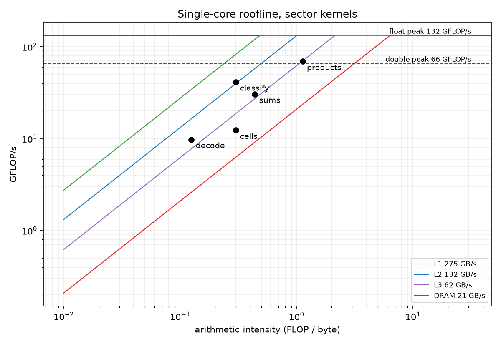

# Lidar packet to brake decision: a measured latency pipeline

> **Dev-box edition. No number here is REPORTABLE.** Everything below was
> measured on a WSL2 laptop (Ryzen 5 5625U, Zen 3) or a shared Runpod pod,
> and neither passes `scripts/rt_check.sh`. On the laptop, the harness
> passed its A/A checks but **failed** to see an injected 1% stall at p99.9
> (section 2). So this edition reports no p99.9 verdict for any change.
> Where a measurement needs an isolated native host, it says so instead of
> giving a number.

<!-- Rule for any later edition: fill a number from results/REPORT.md only
     when it comes from a REPORTABLE run (scripts/rt_check.sh passed) on a
     machine where scripts/validate_harness.sh printed PASS. -->

## 1. Budget

At 50 km/h with 6 m/s² braking and a 300 ms sense-to-brake delay, the
vehicle must brake for any corridor obstacle nearer than **21.27 m**. Each
millisecond of compute costs 1.4 cm of that distance. Compute may cost at
most a third of a voxel (6.7 cm), which gives the targets, stated before
anything was measured (docs/budget.md):

| quantile | target |
|---|---|
| p50 | ≤ 1 ms |
| p99 | ≤ 2 ms |
| p99.9 | ≤ 4 ms |

Data age dominates compute either way: processing the 60° forward sector
when it completes, rather than the full frame, cuts worst-case data age from
100 ms to 16.7 ms. That is a bigger win than every rung below put together.

## 2. Result

**Final p99.9: not measured.** It needs a native Linux host with an isolated
core, and none was available. Below is what the dev box can and cannot say.

### Against the budget, on the dev box

Medians over 10 runs of each run's quantile, from the ladder in section 3
(60° sector, paced at 10× real time, 5000 decisions per run):

| rung | p50 | p99 | p99.9 | worst run's p99.9 |
|---|---|---|---|---|
| naive | 775 µs | 2.67 ms | 6.24 ms | 7.19 ms |
| simd | 141 µs | 1.15 ms | 4.24 ms | 7.26 ms |
| mt (final) | 125 µs | 1.92 ms | 6.73 ms | 356 ms |
| target | ≤ 1 ms | ≤ 2 ms | ≤ 4 ms | |

The final pipeline's median is 8× inside its target. Its tail is not, and
on this host the tail tracks the OS, not the code. In the same session,
every rung's p99.9 landed between 4 and 7 ms, while the medians differ by
6×. The 356 ms run was an mt run whose helper thread, on a CPU nobody
isolated, was descheduled. These are dev-box numbers, not a verdict
against the budget.

### The harness, validated (and where it failed)

`scripts/validate_harness.sh` on the dev box: 8 runs per arm, 2000
decisions per run, mlock, no isolation. Columns are speedups (base ÷
candidate) of per-run quantiles, with a 95% BCa CI (analysis/compare.py).

| check | expectation | p50 | p99 | p99.9 | outcome |
|---|---|---|---|---|---|
| A/A, spin 50 µs | all same | 1.000 [1.000, 1.000] | 0.971 [0.909, 1.069] | 0.495 [0.027, 1.667] | pass |
| A/A, naive | all same | 1.004 [0.997, 1.012] | 1.000 [0.940, 1.091] | 0.997 [0.323, 2.447] | pass |
| +200 µs on every decision | p50 slower | 0.200 [0.200, 0.200] | 0.243 [0.225, 0.255] | 0.370 [0.196, 0.446] | pass |
| +200 µs on 1% of decisions | p99.9 slower, p50 same | 0.998 [0.997, 0.998] | 0.257 [0.238, 0.272] | 0.786 [0.326, 1.598], p = 0.50 | **fail** |

The A/A p99.9 CIs span 0.03× to 2.4×, so the box's own tail noise is larger
than a 200 µs effect. p99 caught the 1% stall, because 1% of decisions sit
right at p99; p99.9 did not. So on this host the harness can judge medians
and p99, but not p99.9.

### OS jitter floor

cyclictest on CPU 3 of the dev box (not isolated, 2.95 M samples): p50
49 µs, p99 184 µs, p99.9 612 µs, max 67.6 ms. A 68 ms hiccup is 17× the
whole p99.9 compute budget. That one number is why the pipeline cannot be
judged on this host.

### Arrival to decision, through the socket

`udp_rx` (simd pipeline) fed by `udp_tx` over loopback, 300 decisions.
Loopback has no NIC clock, so the wire timestamp is missing by design; the
kernel software receive timestamp is the earliest "arrival" available.

| arrival defined as | p50 | p90 | p99 |
|---|---|---|---|
| kernel receive timestamp | 138.0 µs | 169.3 µs | 193.0 µs |
| `recvmsg` return in user space | 117.6 µs | 139.4 µs | 163.1 µs |

The ~20 µs gap at p50 is the kernel-to-user wake-up path. With 300
decisions, p99.9 is just the maximum, so it is not reported. The two-machine
version (NIC hardware timestamps, tcpreplay from a second host,
`scripts/external_rx.sh` / `external_tx.sh`) is written and builds, but has
**not been run**: it needs two native machines and a NIC that lists
`hardware-receive` in `ethtool -T`.

## 3. Optimization ladder (60° sector)

`scripts/ladder.sh` on the dev box runs every rung as an arm of one
interleaved, randomized session. Each rung gets 10 runs of 5000 decisions,
drawn across 4 link orders, paced at 10× real time. The measured core is
pinned to CPU 3 and the mt helper to CPU 4, neither isolated. SCHED_FIFO
was refused (`rt=mlock+pin+nofifo`), so the threads ran at normal priority.

Speedup is the median over runs of the base's quantile divided by the
candidate's, with a 95% BCa bootstrap CI and a Mann-Whitney U p-value
(analysis/compare.py, α = 0.0033 after Bonferroni over 15 tests). Each rung
is compared with the one below it. Only p50 gets a verdict. The p99 CIs
are reported, but none of them clears its test. p99.9 is left unjudged,
because on this host the harness failed to see a 1% stall at p99.9
(section 2).

The counter column comes from `scripts/perf_rung.sh`: closed loop, 20000
decisions, user-space events only (`perf_event_paranoid=2`). Zen 3 under
WSL2 exposes no LLC events and no top-down.

| rung | change | hypothesis (from the profile, written first) | counter evidence | cycles/decision | p50 speedup [CI] | p99 speedup [CI] |
|---|---|---|---|---|---|---|
| 0 naive | baseline | — | `std::sort` internals are 57% of samples (introsort 42%, insertion sort 15%); IPC 1.50; branch miss 5.86% | 3.68 M | — (775 µs) | — (2.67 ms) |
| 1 nth | `std::sort` → `std::nth_element` for the lowest-point seed | sorting dominates decision time; selection is O(n) | sort gone from the profile, `introselect` 7%; IPC 2.74; branch miss 1.65% | 1.61 M (2.29× fewer) | **3.19× [3.16, 3.27]** | 1.73× [1.26, 2.60], inconclusive |
| 2 soa | AoS `Point` → SoA arrays (with `char8_t` labels, rung 2b) | GPF passes read 1-3 of 5 fields; SoA streams only those | L1d loads per decision 1.73 M → 1.16 M; `push_back` (21% in nth) gone | 1.33 M (1.21× fewer) | **1.11× [1.09, 1.12]** | 1.06× [0.74, 1.57], inconclusive |
| 3 simd | Highway kernels | loops are now dense and branch-free; 8 float lanes | llvm-mca (znver3): IPC 3.7-4.8 per kernel; roofline probe 30.0 float FLOP/cycle of Zen 3's 32 | not counted | **1.55× [1.53, 1.58]** | 1.27× [0.87, 1.68], inconclusive |
| 4 mt | fork-join over a spinning pool, 1 helper | ~100 µs parallel region vs sub-µs hand-off | — | not counted | **1.13× [1.10, 1.17]** | 0.60× [0.33, 1.33], inconclusive |
| 5 | ThinLTO / PGO / AutoFDO / BOLT on rung 3 | little: hot code is a few vector loops | — | — | not measured | not measured |
| 6 | one CUDA kernel (decode) | transfer + launch exceed CPU decode at this size | see below | — | **CPU 50× faster per packet, 8× per sector** | n/a |

**Cumulative, naive → mt: 6.20× at p50 [6.01, 6.43].** At p99 the result
is 1.39× [0.77, 3.17], inconclusive.

Two things the table shows:

- **Wall time beat counted work at rung 1.** nth cut cycles per decision by
  2.29×, but p50 fell 3.19×. The counters cover user space only, and the
  counter and timed runs differ in pacing (closed loop vs 10×). The gap
  has not been explained. Page faults or kernel time from naive's
  allocations are one candidate, but no run has tested it.
- **mt buys median and costs tail.** One helper takes 11% off p50. But the
  helper is a second thread on an unisolated CPU. When the OS deschedules
  it, the measured thread waits at the join, and mt's p99 and p99.9 come
  out worse than simd's (0.60× and 0.63×), though neither clears the
  test. On this host, simd is the better rung for the budget that matters.
  Whether mt keeps its median win without the tail cost needs isolated
  cores.

Rung 6 was measured on a Runpod pod: an RTX 2000 Ada, an EPYC 7352 pinned
to CPU 0, a shared host and no isolation. The GPU output was bit-identical
to the CPU's. p50 over 2000 reps:

| stage | 1 packet (767 points) | 60° sector (12 packets, 11557 points) |
|---|---|---|
| host → device | 8.4 µs | 49.1 µs |
| kernel | 11.3 µs | 9.4 µs |
| device → host | 10.8 µs | 49.0 µs |
| host compaction | 2.7 µs | 40.8 µs |
| **GPU total** | **39.2 µs** | **161.9 µs** |
| **CPU simd decode** | **0.79 µs** | **20.7 µs** |

The kernel itself is under 10% of the sector's GPU time; the copies are
61%. A second run at 50000 reps reproduced both ratios (51.8× and 8.1×).
A faster GPU would shrink only the smallest row in that table, so the
result would not change.

Coz was planned as a cross-check of the ladder (scripts/coz.sh). It did not
run: Ubuntu 24.04's coz-profiler 0.2.2 aborts at startup, even on a trivial
program.

## 4. Roofline



Dev box, ceilings measured by `roofline_probe` at 4.41 GHz: L2 132 GB/s,
float peak 132 GFLOP/s (30.0 FLOP/cycle), double peak 65.7 GFLOP/s.

| kernel | precision | intensity (FLOP/B) | achieved GFLOP/s | L2 ceiling GFLOP/s | % of ceiling |
|---|---|---|---|---|---|
| decode | float | 0.125 | 9.81 | 16.54 | 59% |
| sums | double | 0.438 | 30.56 | 57.87 | 53% |
| products | double | 1.125 | 69.37 | 65.65 | 106% |
| classify | float | 0.300 | 41.37 | 39.68 | 104% |
| cells | float | 0.300 | 12.38 | 39.68 | 31% |

- **products** and **classify** sit at their ceilings. Readings slightly
  above 100% mean the probe underestimates the ceiling by a few percent on
  this host (turbo varies under WSL2). They do not mean the kernels beat
  the hardware.
- **sums** reaches 53%. It keeps one accumulator chain per moment, so it is
  bound by add latency, not bandwidth: llvm-mca attributes 75% of its
  cycles to register dependencies.
- **cells** reaches 31%. Its work is compares and float-to-int converts,
  which the FLOP count doesn't see, so it looks far from the roof when it
  is in fact busy: llvm-mca shows 85% resource pressure.
- **decode** reaches 59%, with 59% of its cycles in register dependencies
  (bit-field unpack chains).

## 5. What didn't work

Kept on purpose. A ladder with no failures is a ladder nobody measured.

- **RANSAC as a ground-truth oracle.** Open3D `segment_plane` fits a plane
  6.4° away from the GPF plane on the pinned frame, through road and
  embankment together, and agrees on only 73% of labels. It is a different
  algorithm, not a reference for this one. Replaced by a float64
  re-implementation of GPF with Open3D's covariance, which agrees on 100% of
  labels.
- **SoA, first attempt, was slower** than the AoS rung below it (dev box,
  closed loop: 193 µs vs 163 µs p50, from development runs not kept in
  `results/`). Root cause: `std::vector<std::uint8_t>` labels. Stores
  through `unsigned char` may alias anything, so every label write forced
  reloads and blocked vectorization. Changing only the element type to
  `char8_t` gave 132 µs.
- **`enum class Label : std::uint8_t`** as the fix: measured no faster
  (197 µs), because clang gives an enum its underlying type's alias set.
- **"SIMD" that was not AVX2.** With `-march=x86-64-v3` alone, Highway's
  static target was SSSE3 (4 lanes, no FMA), because its AVX2 target also
  requires AES and CLMUL. The roofline probe exposed it: 15.8 float
  FLOP/cycle against Zen 3's 32, and no `vfmadd` in the binary. Fixed with
  `-maes -mpclmul` plus a `static_assert` on the target. The probe now
  reads 30.0 FLOP/cycle. In closed-loop development runs, simd vs soa went
  from about 1.2× to 2.3×; the paced ladder (section 3) measures 1.55×.
- **mt on an unisolated helper core.** It won 1.13× at p50 but lost at the
  tail, including one run with a 117 ms p99 (section 3).
- **Measuring on WSL2.** A/A runs passed, but a 200 µs stall on 1% of
  decisions was not detected at p99.9 (p = 0.50 in the kept run; section
  2). The hypervisor's own tail (cyclictest max 67.6 ms) was larger than
  the effect. Hence the requirement for native Linux, isolcpus and
  SCHED_FIFO, which this edition could not meet.
- **CUDA decode.** It lost by 50× per packet and 8× per sector, because
  the PCIe copies alone outweigh the whole CPU decode (section 3).
- **Coz.** The distro build aborts at startup, so there is no causal
  profile to set beside the ladder.

## 6. Threats to validity

- **No isolated host.** Every timing comes from WSL2 or a shared cloud pod.
  Medians and p99 are indicative there; p99.9 is not (section 2).
- **Counters are not latency.** Cycles of counted user-space work miss
  kernel time and waiting. Rung 1's wall-time gain beat its cycle gain,
  and rung 4's cost shows only in the timed tail.
- **No SCHED_FIFO.** The ladder ran at normal priority
  (`rt=mlock+pin+nofifo`), so other work on the box competed with it for
  the CPU.
- **Mixed machines.** Rungs 0-3 and the roofline come from a Zen 3 laptop;
  rung 6 from an EPYC 7352 and an RTX 2000 Ada. Ratios are only compared
  within one machine.
- One pinned frame, looped. Caches stay warmer than a stream of distinct frames would leave them.
- Static-obstacle TTC (closing speed = ego speed); no tracking.
- Single-plane ground; a crowned or banked road is approximated.
- PGO/AutoFDO/BOLT would be trained on the 360° workload and measured on
  the 60° one.

## 7. Reproduce

```bash
git clone <this repo> && cd <repo>
scripts/reproduce.sh --check   # anywhere, including the Docker image
scripts/reproduce.sh           # on a prepared native host (scripts/rt_check.sh)
```

`--check` (build, unit, scene and equivalence tests, ASan, TSan,
differential tests against the Ouster SDK and Open3D, 60 s of fuzzing)
passes in the pinned Docker image. The full run is what a REPORTABLE
edition of this write-up needs.
